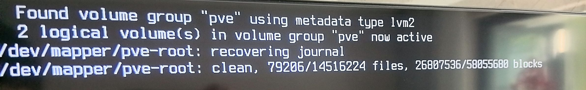

本身家里云跑的好好的，早上起来发现有一个平台的离线短信，赶紧查看发现死了，于是开始抢救。  

## 目录  

[1. 检查情况](#检查情况)  
[2. 分析问题](#分析问题)  
[3. 从lvm恢复数据](#从lvm恢复数据)  
[4. 从zfs恢复数据](#从zfs恢复数据)  
[5. 重建虚拟机和容器](#重建虚拟机和容器)  
[6. 收尾](#收尾)  

---

# 检查情况  
## 初步检查  
风扇处于正常转动状态，但是web和ssh均无法连接，所有虚拟机呈现为离线  
邮箱存在磁盘告警，最后一次告警时间为2:38，未收到备份成功信息  
## 旧磁盘状态：  
系统盘：M.2 SATA硬盘256G（以下简称NGFF），全部分给lvm2，无块存储（lvm-thin）  
数据盘：SATA固态硬盘512G（以下简称SATA），全部分给ZFS，启用压缩  
系统盘告警`2 Currently unreadable (pending) sectors`（超过一个月）；  
数据盘告警`1 Offline uncorrectable sectors`（新）且崩溃几小时前的告警为`3 Currently unreadable (pending) sectors`（超过一个月）  

---

# 分析问题  
## 尝试重启  
硬重启整机，内核可以正常加载，但是卡在磁盘整理无法进入系统。  

尝试进入救援模式，无法成功进入  
## 尝试读盘  
NGFF为lvm2，无法通过常规手段读取，但是未出现明显问题  
SATA为ZFS，无法通过常规手段读取，但是存在超级块（Super Block）损坏  
## 确认问题  
根据以上信息，初步判断是SATA盘的问题，准备进行数据恢复  

---

# 从lvm恢复数据  
将NGFF连接至新安装的pve，准备挂载  
> [!NOTE]
> 如果新旧pve安装时使用的域名均为`pve.your.domain`，lvm的名称也会均为pve无法直接操作，需要重新命名  
> 如果安装时节点名本身就不一样，那可以跳过下面的重命名，直接挂载进行操作

## 挂载lvm 
先扫描卷组，使用`pvscan`和`vgscan`  
`vgscan`输出显示两个pve卷组，说明存在名称冲突。此时需要用 UUID 重命名旧卷组  
```bash
# 获取卷组UUID
vgs -o vg_name,vg_uuid
# 根据卷组UUID重命名卷组  
vgrename <your uuid> pve-old
# 激活重命名后的旧卷组  
vgchange -ay pve-old
```
为了方便恢复数据，挂载之  
```bash
# 创建挂载点
mkdir /mnt/old_data
# 下面以根目录为例，如果还有别的逻辑卷操作是一样的
mount /dev/pve-old/root /mnt/old_data
```
旧的文件在`/mnt/old_data/root/var/lib/vz`  

## 拷贝数据
由于我的系统盘只有*备份*类型的数据，所以直接将`/mnt/old_data/root/var/lib/vz/dump`目录下的所有文件（或者按需也可以）  
如果有虚拟机或者容器的磁盘，也可以一并拷走  

## 获取虚拟机配置  
为了一致性或者其他的什么原因，直接使用原始配置是最好的  
配置文件存储在`/var/lib/pve-cluster/config.db`中，所以将其取出  
```bash
scp root@<pve ip>:/mnt/old_data/var/lib/pve-cluster/config.db config.db
```
读取这个数据库文件的`tree`表，在`name`列进行筛选，找到所有`<id>.conf`，对应右侧的`data`即为对应id的配置文件  
> [!IMPORTANT]
> 注意区分虚拟机和容器，数据库中并未区分但是通过配置文件很好区分  

---

# 从zfs恢复数据
先将SATA盘接入新pve，让系统识别一下  
```bash
zpool import
```
然后导入存储  
```bash
# 由于直接从生产环境取下，源zfs并未导出，需要使用-f参数强制导入
zpool import <your zfs> -f
```
此时存在不健康的告警和超级块损坏使用备用超级块的提示，证明判断无误  
zfs导入后，还需要让pve识别它，这样才能快速迁移操作，在此之前先消除告警  
```bash
zpool clear <your zfs>
```
在Web管理界面中，添加刚导入的zfs，这里我将存储ID设置与旧的pve一致，以便恢复虚拟机和容器  

---

# 重建虚拟机和容器  
## 从备份恢复  
之前从dump复制了原有的备份文件，对于有备份的虚拟机或者容器，直接在pve存储管理选中备份进行还原即可，十分便捷  
虽然没有收到备份成功的邮件，但是我的数据确实备份成功了，省了我不少事  
## 从配置文件恢复  
根据之前取回的数据库，将对应的配置文件放到合适的地方（容器放在`/etc/pve/lxc`，虚拟机放在`/etc/pve/qemu-server`）  
刷新容器  
```bash
pct rescan
```
对于直接按照id复制的虚拟磁盘或者zfs中id没变的虚拟磁盘，刷新管理界面后会直接出现  
如果拷贝时改了id或者路径，对应修改配置文件即可  
在web页面进入虚拟机/容器的管理页面，把SATA上的虚拟磁盘选择`移动存储`来转移到新的local上  

此时虚拟机和容器就重建完了  

---

# 收尾  
如果原本有独特的网络结构，那么按照原有的设置一下  
当然移除旧的存储也是不可少的  
### 移除旧的lvm  
```bash
# 先取消挂载
umount /mnt/old_data
# 取消激活lvm
vgchange -an pve-old
# 删除挂载点
rm -r /mnt/old_data
```
### 移除旧的zfs  
先在web界面移除zfs存储，然后导出  
```bash
zpool export <your zfs>
```
在web页面把`移动存储`残留的虚拟磁盘选择移除  
### 验证恢复情况  
启动虚拟机或者容器，检查恢复情况  